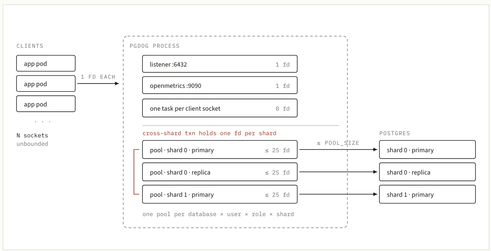
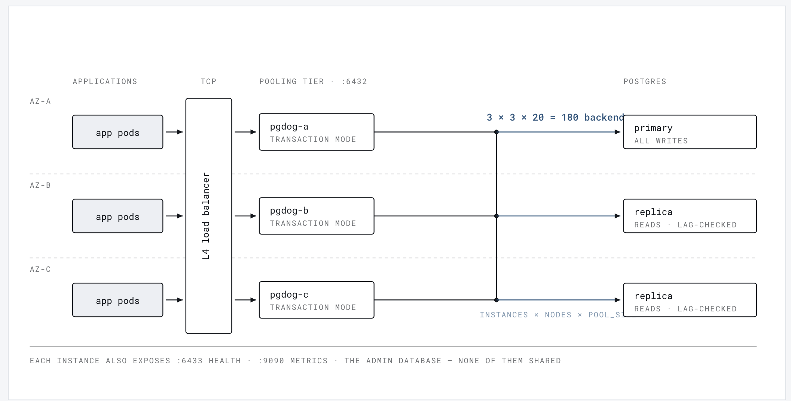
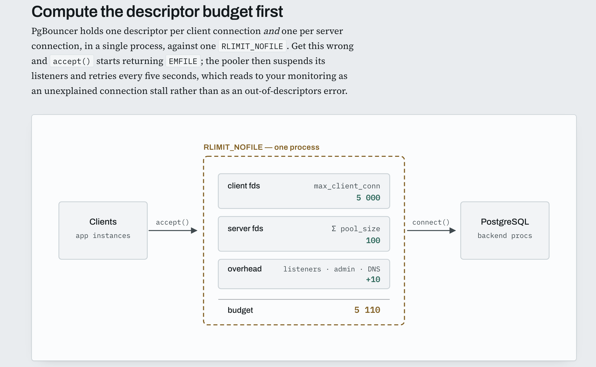
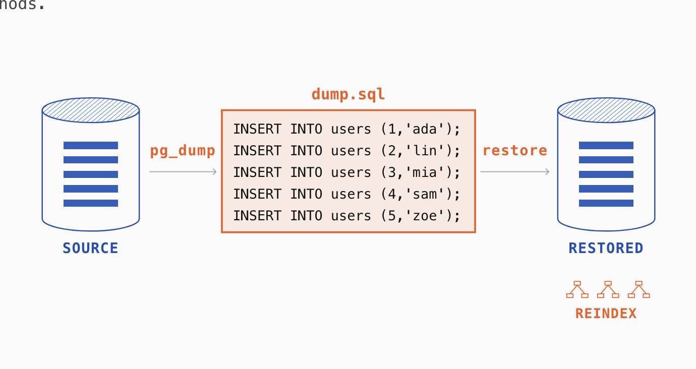
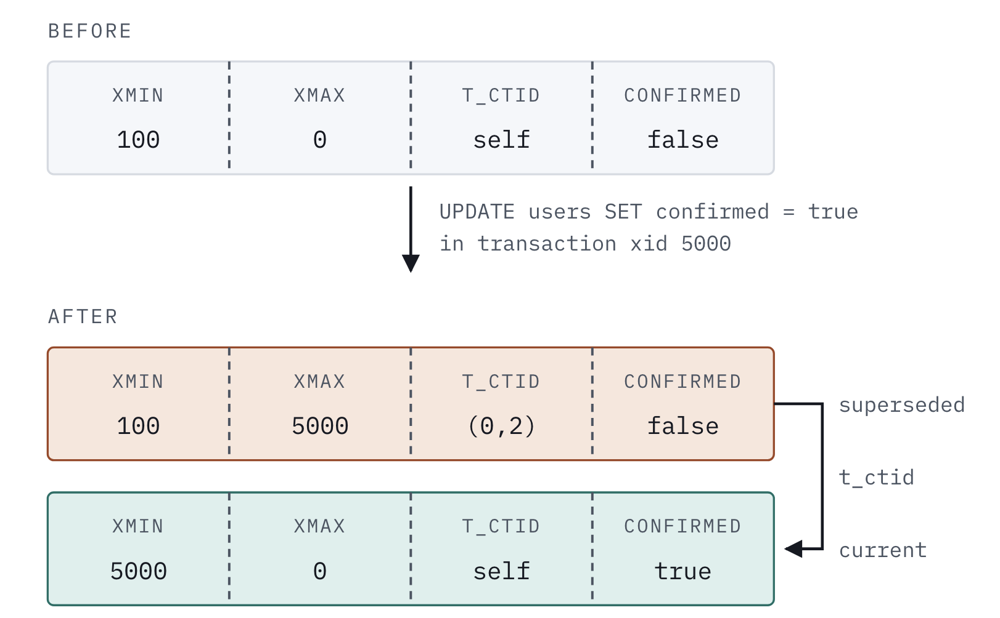
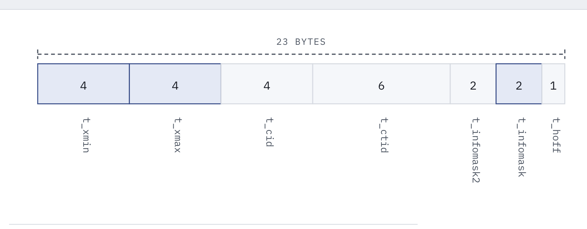

# pgdog-playground

A multi-threaded Rust proxy that rolls connection pooling, load balancing, and sharding into one layer.

Why it's different — a real SQL parser keeps the Postgres features other poolers make you give up:

- `SET` and Row-Level Security keep working: per-client session state is re-applied before each query.
- `LISTEN / NOTIFY` survive transaction pooling via in-process broadcast channels.
- Transparent prepared statements, one Tokio process across all cores, and a PgBouncer-style admin database plus OpenMetrics.

## File descriptors and Postgres

> Postgres's architecture is essentially an application built on fd inheritance.

```text
                    postmaster  (the "master process")
                    ├── binds :5432 + /tmp/.s.PGSQL.5432
                    ├── owns shared memory (shared_buffers)
                    ├── forks and supervises everything
                    │
     ┌──────────────┼──────────────┬─────────────┬──────────────┐
     ▼              ▼              ▼             ▼              ▼
 backend #1     backend #2     checkpointer  WAL writer    autovacuum
 (your conn)    (your conn)                                 launcher
 fd 9 = client  fd 9 = client
 SESSION state  SESSION state
```

The postmaster never touches your data. It doesn't parse SQL, doesn't read tables, doesn't hold your session. It is a supervisor: bind, accept, fork, reap. All real work happens in a child process — one per connection.

`fork()` duplicates the whole fd table, so a new backend starts life holding every descriptor the postmaster had — including the listening sockets. `ClosePostmasterPorts()` runs first thing in the child and throws away everything it must not keep. Leave a listen socket open in a backend and that backend can accept connections, and the port stays bound after the postmaster exits.

## Odyssey

A file descriptor is an index into a per-process table. Any thread in the process can `read()` it with zero ceremony; another process needs `SCM_RIGHTS` over a Unix socket to get a copy.

Design consequence: Odyssey is one process with N threads (workers), not N processes. PgBouncer, by contrast, uses a single-process, single-thread model.

The array can never be resized, so its size must be known before any traffic. That's the entire reason `limits.c` exists. `compute_ideal_maxsock()` (`limits.c:194`) is literally an fd budget:

- `maxconn * 2` (one client + one server socket)
- `+ maxpipes * 2`
- `+ nbthread` epoll fds
- `+ 2 * nbthread` wake-up pipes
- plus SSL async engine fds

`maxconn` is derived by inverting that formula against `RLIMIT_NOFILE` (`limits.c:115`). When pipes are unlimited, the solve is `maxconn = 2 * remain / (5 + 2 * engine_fds)`.

## HAProxy

In HAProxy the file descriptor is not a handle that gets passed around — it is the primary key of the entire runtime. Three properties of POSIX fds (small dense integers, lowest-free allocation, a hard process-wide ceiling) propagate outward into the memory layout, the threading model, the polling fast path, and the advertised capacity of the process.

## PgDog

Postgres is process-per-connection — every client costs a backend process plus its fds, and `max_connections` is a hard wall. PgDog's entire value is decoupling the two sides of the fd ledger: N client fds on the front, a fixed `pool_size` server fds on the back.

### Sharding is an fd multiplier

`Binding::MultiShard(Vec<Guard>, ...)` (`binding.rs:28`) means one client holds one server fd per shard for the life of the transaction. Total server fds is roughly:

```text
Σ over (database × user × role × shard) of pool_size
```

Cross-shard traffic is where a comfortable fd budget turns tight, and where an undersized `pool_size` turns into checkout starvation rather than just latency.





## The formula PgBouncer itself uses



This is not folklore — `check_limits()` computes exactly this at startup and logs it against the live `rlimit`.

Descriptor budget:

```text
# forced user per database (recommended):
max_client_conn + (pool_size × databases) + 10

# each login user gets its own pool:
max_client_conn + (pool_size × databases × users) + 10
```

## Pool mode and pool sizes

`pool_mode` is the multiplexing ratio. Session mode pins one server descriptor per client descriptor for the client's entire lifetime — it buys you nothing but proxying. Transaction mode is where a pooler earns its keep, and it is the only mode in which PgBouncer's prepared-statement tracking applies.

```ini
# pgbouncer.ini
pool_mode = transaction
max_client_conn = 5000            ; default 100 — per process
default_pool_size = 25            ; default 20 — server conns per db/user pair
min_pool_size = 5                 ; default 0 — absorbs cold-start bursts
reserve_pool_size = 5             ; default 0 — overflow above pool_size
reserve_pool_timeout = 3          ; default 5 — wait before reserve opens
max_db_connections = 100          ; default 0 (unlimited) — hard cap per database
max_prepared_statements = 200     ; 1.25 default; transaction/statement mode only
server_round_robin = 0            ; LIFO reuse keeps the working set hot
```

## Getting started

```sh
helm repo add pgdogdev https://helm.pgdog.dev
helm install pgdog pgdogdev/pgdog
```

Or with Docker:

```sh
docker run ghcr.io/pgdogdev/pgdog:latest
```

## Postgres backups

Reference: [Postgres backups under the hood](https://planetscale.com/blog/postgres-backups-under-the-hood)

There are three different ways to back up a Postgres database: logical backups (`pg_dump`), file system backups, and continuous archiving.

### Logical backups

`pg_dump` is a purely logical backup that exports a consistent snapshot of the database, and is the simplest way to back up a Postgres database. At its core, `pg_dump` reads the current state of the database and writes the data to a given output.

`pg_dump` can create dumps in either plain text as SQL statements (with SQL queries such as `COPY` or `INSERT`), or custom `pg_dump` formats designed for use with `pg_restore`.

- Logical backups lack the ability to do point-in-time recovery (PITR) since the backup is a static snapshot of data at a given time. However, they are particularly useful for facilitating migrations.



#### Logical backups and transaction wraparound

Logical backups leverage Postgres's MVCC support in order to take a consistent backup while the database is online. When `pg_dump` starts, it opens a transaction in one of two ways:

```sql
-- pg_dump with the default settings
BEGIN;
SET TRANSACTION ISOLATION LEVEL REPEATABLE READ, READ ONLY;
...

-- pg_dump --serializable-deferrable
-- Ensures transactions are serializable while the backup is being taken.
-- Generally not recommended for backups intended for disaster recovery.
-- See the --serializable-deferrable flag for pg_dump:
-- https://www.postgresql.org/docs/current/app-pgdump.html
BEGIN;
SET TRANSACTION ISOLATION LEVEL SERIALIZABLE, READ ONLY, DEFERRABLE;
...
```

Every transaction that modifies data gets assigned an internal id, referred to as its `xid`. Rows in the database contain a hidden field named `xmin`, which holds the `xid` of the transaction that created that row version, while `xmax` holds the `xid` of the transaction that deleted, updated or locked it.

### Continuous archiving

The most powerful (and complicated) backup method is continuous archiving. Continuous archiving combines a file system backup with the write-ahead log (WAL).

#### The WAL

The WAL is like your database's logbook. Every change, addition, or deletion of the data in your database is written down in the WAL.

Before Postgres makes any changes to data on disk, it first records the changes in the WAL. This ensures that upon a system crash, Postgres can restore to a consistent state by replaying the data mutations saved in its WAL.

The WAL is by default saved in 16MB segments as binary files, however the size is configurable per cluster. These can be fed to tools such as `pg_waldump`, yielding human-readable output.

### Backups vs. replication

A backup is a point-in-time snapshot of your data, whereas replication is the continuous copying of live data from a primary server to one or more standby servers.

| Scenario | Backup | Replication |
| --- | --- | --- |
| Human error protection | Yes. If an engineer runs `DROP TABLE` at 2:00 PM, you restore from the 1:00 PM backup. | No. If you run `DROP TABLE` on the primary, that statement propagates instantly to all replicas. |

Replication is not a substitute for backups because replication copies mistakes instantly. If data gets corrupted or accidentally wiped, your replicas will faithfully copy that corruption.

In production environments, Postgres architectures use both together:

- Replication keeps a secondary database live for instant failover if the primary node crashes.
- Physical backups + WAL archiving (PITR) continuously stream write-ahead logs to storage (like S3), allowing you to roll back the database to 1 second before a human mistake occurred.

## Multi-Version Concurrency Control (MVCC)

What MVCC solves: readers never block writers, writers never block readers.

In older or simpler databases, if Query A wants to update a row, it puts an exclusive lock on that row. If Query B wants to read that same row, it has to wait until Query A finishes. This creates massive performance bottlenecks.

MVCC avoids locks for read operations by keeping multiple physical versions of the same row on disk at the same time.

A traditional database makes readers take locks so nobody changes a row mid-read. Postgres instead never modifies a row in place. An `UPDATE` writes a new copy of the row and marks the old one as superseded. Both physically exist afterward.

The price is that your table accumulates dead versions someone has to clean up — which is what `VACUUM` is for, and where the whole xid problem comes from.

Postgres never overwrites a row. It writes a new copy and stamps both with transaction numbers — and because those numbers are only 32 bits wide, that one decision produces vacuum, freezing, bloat, and the wraparound shutdown.



An `UPDATE` is an insert plus a tombstone. The original tuple keeps its `xmin` and gains an `xmax`; the new tuple is written elsewhere on the page. Nothing was overwritten, so a transaction that started before xid 5000 still reads the top row quite happily.

Every tuple on disk has a 23-byte header in front of the actual column data. Three of its fields decide who can see it.



The shaded fields are the visibility machinery. `t_xmin` and `t_xmax` name the transactions; `t_infomask` caches what became of them.

### Half the world is always behind you

Everything so far rests on comparing transaction ids. And an xid is 32 bits, which means "older than" cannot mean what you think it means.

With signed 32-bit subtraction, there is no absolute ordering of transaction ids — only a relative one, and it always splits the space exactly in half: 2³¹ ids behind you, 2³¹ ahead, no matter where you are. As the counter advances, that boundary sweeps.

## Connection pooler

PgDog is first and foremost a connection pooler. It can proxy thousands (even hundreds of thousands) of application connections with only a handful of actual PostgreSQL connections. This feature is essential to large and busy databases. Without connection pooling, it would be very difficult to use Postgres in production.

### Connection state

PgDog can handle `SET` commands and preserve connection state in transaction mode. For example, this command works without polluting the connection state for other clients:

```sql
SET application_name TO 'sidekiq';
```

PgDog preserves this and other session parameters in transaction mode, allowing multiple applications to use the same connection pool. This increases pool efficiency at the small cost of running a few extra `SET` commands.

What sets PgDog apart is its ability to reuse the same connection pool to serve more clients inside the same process. This improves pool utilization and allows PgDog to keep the number of connections to PostgreSQL low while serving more queries per second than PgBouncer.

### Metrics

PgDog runs as one multithreaded process, and it starts one OpenMetrics listener for that process. When Prometheus scrapes `/metrics`, PgDog gathers the metric families into a single response; they aren't emitted separately by each worker thread.

Enable the endpoint in `pgdog.toml`:

```toml
[general]
openmetrics_port = 9090
```

Then configure one scrape target for each PgDog instance:

```yaml
scrape_configs:
  - job_name: pgdog
    static_configs:
      - targets: ["pgdog:9090"]
```

### Pub/sub

If your application uses `LISTEN/NOTIFY`, e.g., DBOS or another job queue, it would traditionally need to connect to Postgres directly. PgDog implements its own pub/sub queue and sends and receives `LISTEN/NOTIFY` messages for clients connected to it.

This allows applications to use `LISTEN/NOTIFY` in transaction mode, just like any other Postgres feature.
